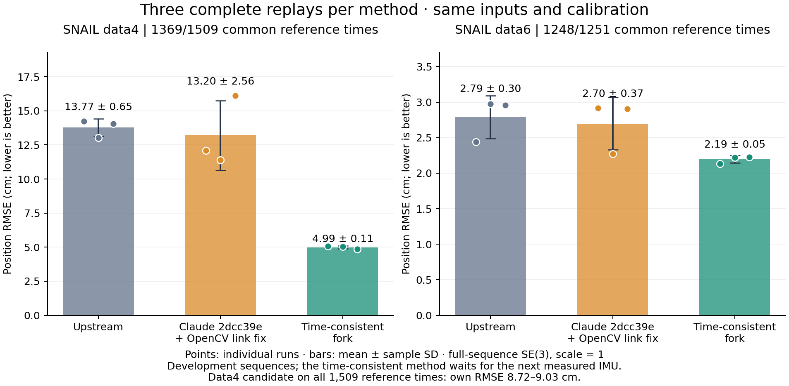

# SNAIL 개선 재검증과 Claude push 검증 — 2026-10-22

GaRLIO 시간 경계 수정본은 data4 반복 재생에서 오차와 출력 누락을 줄였다. 다만 실제 다음 IMU 샘플을 기다리는 방식이며, 센서 시각상의 연속 궤적을 즉시 출력과 혼동하면 안 된다. 시간 기능은 기본 false이고 이번 실험 프로필에서 true다. 아래는 두 개발 시퀀스의 결과이며, 논문 전체 실험이나 실로봇의 보편적 성능 우위를 뜻하지 않는다.

**Claude의 정확한 원격 커밋 `2dcc39e70e2e8eb43649820d2315ef78b34a5838`는 clean build에서 OpenCV 링크에 실패했다.** 비교표의 Claude 행은 `cloudProcess`에 `${OpenCV_LIBRARIES}` 한 항목만 연결한 별도 진단 사본이다. 알고리즘은 그 원격 소스와 같다. 정확한 원격 커밋 자체가 통과했다고 보고하지 않는다.

초기 Claude 이름의 네 실행은 제 빌드 캐시 오류로 이전 바이너리를 실행한 것이어서 무효 처리하고 수치를 철회했다. [오류 원인·정정·해시 증거](../experiments/snail_2026_10_22/BUILD_CACHE_INCIDENT.md), [링크 수정 patch](../experiments/snail_2026_10_22/claude_2dcc39e_opencv.patch)를 보존한다. 시간 경계 수정본은 독립 clean build 후 두 실행 파일의 해시가 기존 실험과 정확히 일치했다.

## 같은 입력의 전체 구간 반복 비교

각 방법 3회. 시간 후보 첫 실행과 후속 두 실행의 차이는 ROS 시각 지연 진단열과 설명 주석뿐이며, 수치 연산 코드는 동일함을 원래 소스 hash로 확인했다. IMU 위치를 LiDAR 원점으로 변환한 뒤 기준 시각에 선형 위치/SLERP 보간한다. 0.2초보다 긴 출력 공백을 연결하거나 외삽하지 않는다. 전체 구간에 하나의 SE(3), scale 1 정렬을 적용한다. 공통점은 과거 JURLIO 비교군까지 포함한 고정 비교 집합이며, 자체 유효점의 오차와 커버리지도 아래에 따로 제시한다. 임의 구간을 잘라 재정렬하지 않았다.

| 구간 | 방법 | 공통 시각 RMSE 평균 ± 표본 SD (cm) | 실행별 RMSE (cm) | 실행별 최대 오차 범위 (cm) |
|---|---|---:|---|---:|
| data4 (1369점) | 공식 GaRLIO ff4dfef | 13.773 ± 0.651 | 14.225, 13.027, 14.066 | 105.524–119.385 |
| data4 (1369점) | Claude 2dcc39e + OpenCV 링크 수정 | 13.202 ± 2.558 | 12.076, 11.399, 16.129 | 81.866–124.456 |
| data4 (1369점) | GaRLIO 시간 경계 + 속도 guard | 4.991 ± 0.114 | 5.069, 5.043, 4.860 | 36.726–37.812 |
| data6 (1248점) | 공식 GaRLIO ff4dfef | 2.790 ± 0.303 | 2.439, 2.975, 2.955 | 9.872–39.730 |
| data6 (1248점) | Claude 2dcc39e + OpenCV 링크 수정 | 2.697 ± 0.369 | 2.913, 2.272, 2.907 | 8.083–39.729 |
| data6 (1248점) | GaRLIO 시간 경계 + 속도 guard | 2.194 ± 0.052 | 2.134, 2.222, 2.227 | 9.341–9.404 |

| 구간 | 방법 | 자체 유효 기준점 | 자체 유효점 RMSE 범위 (cm) | 최대 출력 시각 간격 (s) |
|---|---|---:|---:|---:|
| data4 | 공식 GaRLIO ff4dfef | 1393/1509 | 17.037–18.058 | 0.933 |
| data4 | Claude 2dcc39e + OpenCV 링크 수정 | 1393/1509 | 14.353–20.047 | 0.933 |
| data4 | GaRLIO 시간 경계 + 속도 guard | 1509/1509 | 8.716–9.027 | 0.191 |
| data6 | 공식 GaRLIO ff4dfef | 1248/1251 | 2.439–2.975 | 0.309 |
| data6 | Claude 2dcc39e + OpenCV 링크 수정 | 1248/1251 | 2.272–2.913 | 0.309 |
| data6 | GaRLIO 시간 경계 + 속도 guard | 1248/1251 | 2.134–2.227 | 0.310 |

data4 후보의 약 5cm 수치는 공통 1,369점 기준이다. 새로 복원한 시각까지 포함한 1,509점 전체의 RMSE는 위 자체 유효점 열을 봐야 한다. 원본에는 그 시각 일부의 추정이 없으므로 자체 RMSE끼리는 동일 표본 비교가 아니다. 커버리지 증가와 함께 해석한다.

- data4: 원본 대비 평균 감소 8.782cm, 두 표본 SD 중 큰 값의 2배 1.302cm다. 사전의 보수적인 차이 판정 기준을 충족했다. 이 규칙은 정식 유의성 검정이 아니며 N=3과 개발 데이터의 한계가 있다.
- data6: 원본 대비 평균 감소 0.596cm, 두 표본 SD 중 큰 값의 2배 0.607cm다. 사전의 보수적인 차이 판정 기준을 충족하지 못했다. 이 규칙은 정식 유의성 검정이 아니며 N=3과 개발 데이터의 한계가 있다.
- Claude + 링크 수정 data4: 원본 대비 평균 감소 0.571cm, 동일 차이 기준 5.116cm, 미충족. 원격 커밋 자체의 빌드 실패와 이 사본의 정확도 결과를 구별한다.
- Claude + 링크 수정 data6: 원본 대비 평균 감소 0.092cm, 동일 차이 기준 0.737cm, 미충족. 원격 커밋 자체의 빌드 실패와 이 사본의 정확도 결과를 구별한다.

## 변경 이유와 처리 구조

1. `src/pointProcess.cpp`가 LiDAR/레이더를 전처리하고 레이더 ego velocity와 정적/비정적 관측을 만든다. 이 전처리 모델은 시간 후보에서 바꾸지 않았다.
2. `src/lidarMapping.cpp::sync_messages()`가 레이더 시각으로 스윕을 나눈다. 시간 후보는 경계 전후의 실제 IMU 샘플을 보존하고 새 샘플이 없는 중간 스윕도 그 측정 구간 안에서 구성한다.
3. `src/imuProcess.hpp`가 각 실제 IMU 구간을 스윕 경계로 잘라 전파와 deskew를 수행한다. 원본처럼 스윕 끝까지 반복 외삽하지 않는다. 초기화에서는 미래 샘플과 이미 누적한 샘플을 중복 사용하지 않는다.
4. 기존 LiDAR·Doppler 갱신을 수행한다. 긴급 Angle Refine의 속도 직접 대입에도 IEKF 전 IMU 예측과의 축별 0.5m/s 기준을 적용해 예측과 크게 다른 레이더 속도의 무조건 대입을 제한한다. 각 IEKF 반복 내부의 Doppler 거부 결과를 그대로 전달하는 플래그는 아니며, LiDAR 재갱신은 유지한다.
5. 중력 적분의 시간 경계와 가속도 스케일을 전파와 맞춘다. 중력/Doppler residual과 Jacobian은 그대로다. 구간을 분할할 때 Q를 조정하는 방식은 구동 분산 합을 보존하는 근사이며 끝점 재사용의 상관관계를 완전히 모델링하지 않는다.
6. 궤적과 진단 로그를 저장하고 독립 평가기로 기준 궤적과 비교한다. 참조 궤적은 상태 추정에 입력하지 않는다.

[논문 III-B, IV-A, IV-C/D](https://arxiv.org/html/2502.07703v2)의 의도와 변경 의존성은 [설계 근거](design_rationale.md)에 기록했다. 기존 기능 OFF는 원인 분리를 위한 대조이며 논문 기능 삭제가 아니다.

## 추가 대조와 회귀

- `g_guard_d4`: RMSE 13.159cm, 최대 101.121cm, 2095 pose, 최대 시각 간격 0.933s.
- `g_all_off_data4`: RMSE 13.837cm, 최대 99.913cm, 2095 pose, 최대 시각 간격 0.933s.
- `j_one_imu_d4`: RMSE 16.254cm, 최대 119.428cm, 2095 pose, 최대 시각 간격 0.933s.
- `g_guard_d6`: RMSE 2.352cm, 최대 9.939cm, 1817 pose, 최대 시각 간격 0.309s.
- `j_one_imu_data6`: RMSE 2.927cm, 최대 39.446cm, 1817 pose, 최대 시각 간격 0.310s.

JURLIO의 수정은 새 IMU가 한 개면 스윕을 버리던 조건 하나다. 전파기가 이전 샘플을 앞에 추가하므로 새 샘플 한 개도 유효하며, 중력 단계의 별도 두 끝점/양수 dt 검사는 유지한다. data4의 기존 baseline 40.810cm·2,051 pose에 비해 개선됐지만, 이 단일 대조를 robust/dynamic 전체 개선으로 일반화하지 않는다.

합성 데이터의 시간 후보 첫 RMSE는 3.804mm로 기존 3.662mm보다 0.142mm 크다. 이 작은 회귀를 숨기지 않는다. 최종 시간 후보 합성 RMSE는 3.802mm다. 공용 실행기의 원본/시간 OFF fork는 각각 3.662mm, JURLIO baseline은 3.676mm로 모두 116개 pose를 출력했다. [전체 시도·검사·합성 수치 JSON](../experiments/snail_2026_10_22/checks_summary.json)에 개별 결과를 보존한다.

## 실행 검사와 상태

이번 추가 실험은 유효한 ROS 재생 27회와 잘못된 바이너리로 실행한 무효 기록 4회다. 무효 4회를 성공으로 세지 않는다. 원격 Claude 커밋의 clean build 실패도 별도로 보존했다. 유효한 재생의 완료가 모든 정확도 조건의 합격을 뜻하지 않는다.

GaRLIO Python 31개, JURLIO Python 18개, GaRLIO C++ 수치 검사 프로그램 2개, JURLIO C++ 수치 검사 프로그램 7개가 통과했다. 공용 비교 실행기로 원본/fork/JURLIO 실제 합성 재생도 마쳤다. GaRLIO 및 JURLIO 각각 build/devel을 비운 독립 재빌드 후 실험 바이너리와 SHA-256이 정확히 같았다. 최초 plotting Python 환경에는 psutil이 없어 검사 하나가 실패했으며, 의존성이 갖춰진 ci_env와 ROS 이미지에서 모두 통과했다.

## 지연과 검증 한계

- `g_final_data4_r3`: ROS 입력 시각 지연 중앙값 0.031s, p95 0.225s, 최대 0.966s. 최대 실측 IMU 지원 간격 0.941s.
- `g_final_data6_r3`: ROS 입력 시각 지연 중앙값 0.029s, p95 0.043s, 최대 0.080s. 최대 실측 IMU 지원 간격 0.027s.
- `g_final_data4_r2`: ROS 입력 시각 지연 중앙값 0.032s, p95 0.215s, 최대 0.953s. 최대 실측 IMU 지원 간격 0.941s.
- `g_final_data6_r2`: ROS 입력 시각 지연 중앙값 0.029s, p95 0.044s, 최대 0.072s. 최대 실측 IMU 지원 간격 0.027s.

이 지연은 처리 중 ROS 시각과 스윕 시각의 차이로 입력 대기와 스케줄링을 포함한다. 최종 publish까지의 엄밀한 wall-clock 지연 측정은 아니다. 미래의 실측 IMU를 기다리므로 긴 공백에서 즉시 출력을 보장하지 않는다. 레이더 메시지가 완전히 끊기는 문제도 별도다.

모든 재생은 같은 bag·외부 보정·1배속·4 CPU·8 GiB이며 이 대화의 estimator끼리는 순차 실행했다. 다른 사용자의 컨테이너가 같은 호스트를 사용할 수 있어 독점 CPU 성능 시험이 아니다. 원본 RANSAC/비동기 변동을 반복값에 포함했다. data4는 이전 실패를 보고 원인을 분석한 개발 구간이며 미사용 평가가 아니다. NTU/Point-LIO/FAST-LIO 전체 연구 계획과 새로운 미사용 시퀀스 일반화는 수행했다고 주장하지 않는다.

## 재현·감시·증거

- 알고리즘 커밋: GaRLIO guard `176422a`, 시간 경계 `44885b4`; JURLIO 한 IMU 스윕 수정 `e1375e5`. 후속 문서/실험 도구 변경은 core source hash와 구분한다.
- [실험 도구와 프로필](../experiments/snail_2026_10_22/README.md), [data4 전체 수치](../experiments/snail_2026_10_22/data4_scores.json), [data6 전체 수치](../experiments/snail_2026_10_22/data6_scores.json), [반복 요약](../experiments/snail_2026_10_22/repeat_summary.json).
- 원시 성공/실패 로그·소스 및 이미지 식별자·실행 명령은 상위 작업 폴더 `output/improvement_2026-10-22/`에 보존한다. 각 실행의 `meta.json`/`experiment.json`을 확인한다. 원본 실제 선택은 pinned SHA/clean 검사로 확인하며 host fork hash와 혼동하지 않는다.
- Claude push는 앱 heartbeat `push-snail`로 5분 간격 확인한다. 사용자 지정이 없으면 GaRLIO main 및 JURLIO jurlio-hunger 신규 생성을 확인한다. 현재 SHA가 그대로면 재실행/알림을 중복하지 않는다. 새 SHA는 별도 스냅샷·clean build·합성 및 두 SNAIL 재생·반복 비교를 수행하며 [검증 절차](../experiments/snail_2026_10_22/WATCH_PROTOCOL.md)를 따른다.
- Claude의 원격 브랜치와 미커밋 hunger 작업 트리는 수정하지 않았다. 링크 수정 사본을 원격 원본으로 위장하거나 미검증 변경을 자동 병합하지 않는다.
